# Mapa de navegación — Contanika

Entregable 3.3. Generado el 11/10/2026 con `python gestionar.py generar_mapa_navegacion` a partir de las rutas del sistema. No editar a mano: volver a generarlo cuando cambien las rutas.

El sistema tiene **110 rutas**: 79 pantallas o descargas (GET) y 31 acciones que solo reciben formularios (POST).

## 1. Navegación general

Toda pantalla exige sesión, salvo la página web de inicio, el inicio de sesión, `robots.txt` y el enlace firmado del PDF de la cuenta de cobro que recibe el cliente. El menú lateral, la campana de vencimientos, la ayuda y el perfil están disponibles desde cualquier pantalla.

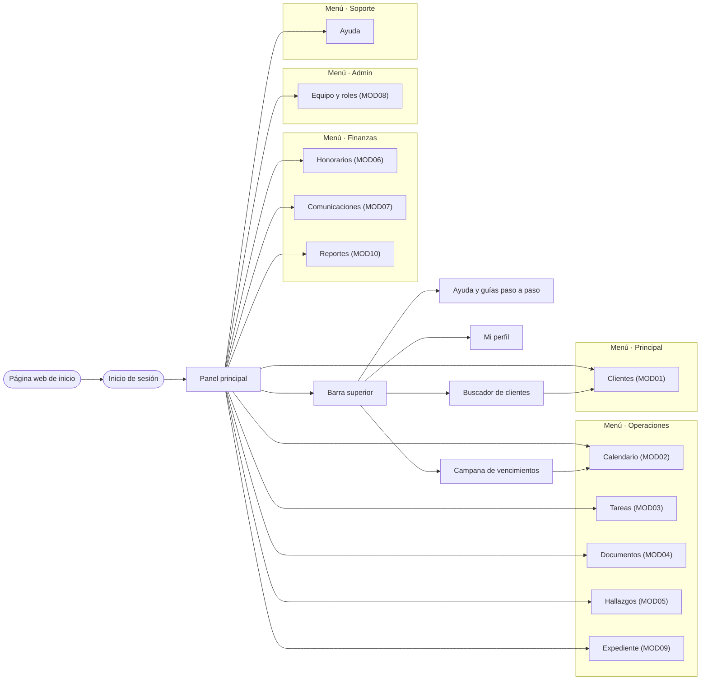

## 2. Rutas por módulo

Columnas de rol: «Sí» = el rol puede abrir la ruta; «—» = recibe 403. Además, un módulo inhabilitado para el rol (Equipo y roles → Módulos por rol) bloquea todas sus rutas. Dentro de una ruta permitida, los datos se restringen según las reglas de cada módulo (por ejemplo, el Contador Junior solo escribe en sus clientes asignados).

### Sin módulo (sesión, panel, ayuda)

| Ruta | Nombre | Métodos | Admin. | Senior | Junior | Qué hace |
|---|---|---|---|---|---|---|
| `/robots.txt` | `robots` | GET | Sí | Sí | Sí | `robots.txt`: pide a los buscadores y rastreadores que no recorran el sistema. *(pública, sin sesión)* |
| `/media/<path:ruta>` | `media` | GET | Sí | Sí | Sí | Sirve las imágenes subidas (foto de perfil, firma y membrete) solo a quien tiene sesión y le corresponden: la foto y la firma, a su dueño o al Administrador; el membrete, a cualquier usuario. Lo demás responde 404. |
| `/` | `seguridad:inicio` | GET | Sí | Sí | Sí | Página web pública de Contanika: presenta la plataforma y lleva al inicio de sesión. *(pública, sin sesión)* |
| `/panel/` | `seguridad:panel` | GET | Sí | Sí | Sí | Panel principal del sistema. |
| `/iniciar-sesion/` | `seguridad:iniciar_sesion` | GET · POST | Sí | Sí | Sí | Formulario de acceso al sistema (CU001). *(pública, sin sesión)* |
| `/cerrar-sesion/` | `seguridad:cerrar_sesion` | GET · POST | Sí | Sí | Sí | Cierra la sesión activa y regresa al inicio de sesión. |
| `/perfil/` | `seguridad:perfil` | GET · POST | Sí | Sí | Sí | Datos propios del usuario; el correo y el rol solo los cambia el Administrador. |
| `/ayuda/` | `seguridad:ayuda` | GET | Sí | Sí | Sí | Guías paso a paso de los procesos, guía rápida de los módulos, preguntas frecuentes y contacto de soporte del despacho. |
| `/ayuda/guias/<slug:slug>/` | `seguridad:guia` | GET | Sí | Sí | Sí | Una guía paso a paso. Solo abre las guías de procesos que el usuario puede hacer (su rol y sus módulos habilitados); las demás responden 403. |
| `/perfil/contrasena/` | `seguridad:cambiar_clave` | POST | Sí | Sí | Sí | Cambio de contraseña propia: exige la actual y conserva la sesión abierta. |
| `/cuenta-cobro/<str:token>/` | `finanzas:pdf_publico` | GET | Sí | Sí | Sí | PDF de la cuenta de cobro para el cliente, sin sesión, por el enlace firmado que recibe en WhatsApp o en el recordatorio. Un token alterado o vencido responde 404. Como es pública, cada dirección IP tiene un tope de peticiones por minuto (429 al pasarse), para que nadie pruebe enlaces en masa. *(pública, sin sesión)* |

### MOD01 · Gestión de clientes

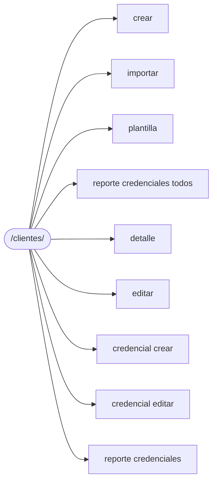

| Ruta | Nombre | Métodos | Admin. | Senior | Junior | Qué hace |
|---|---|---|---|---|---|---|
| `/clientes/` | `clientes:lista` | GET | Sí | Sí | Sí | Listado de clientes con filtros desplegables y paginación configurable. |
| `/clientes/nuevo/` | `clientes:crear` | GET · POST | Sí | Sí | Sí | Registra un cliente nuevo con sus municipios y servicios. |
| `/clientes/importar/` | `clientes:importar` | GET · POST | Sí | Sí | — | Carga un archivo Excel, valida cada fila e importa las filas válidas. |
| `/clientes/plantilla/` | `clientes:plantilla` | GET | Sí | Sí | — | Descarga la plantilla de Excel para la importación masiva de clientes. |
| `/clientes/credenciales/reporte/` | `clientes:reporte_credenciales_todos` | GET | Sí | Sí | Sí | Reporte consolidado de credenciales de todos los clientes (solo en pantalla, sin descarga). |
| `/clientes/<int:pk>/` | `clientes:detalle` | GET | Sí | Sí | Sí | Ficha completa del cliente con sus servicios, municipios y credenciales. |
| `/clientes/<int:pk>/editar/` | `clientes:editar` | GET · POST | Sí | Sí | Sí | Actualiza la ficha de un cliente existente. |
| `/clientes/<int:pk>/inactivar/` | `clientes:inactivar` | POST | Sí | Sí | — | Inactiva un cliente conservando todo su historial. |
| `/clientes/<int:pk_cliente>/credenciales/nueva/` | `clientes:credencial_crear` | GET · POST | Sí | Sí | — | Crea una nueva credencial para un cliente. |
| `/clientes/<int:pk_cliente>/credenciales/<int:pk>/editar/` | `clientes:credencial_editar` | GET · POST | Sí | Sí | — | Edita una credencial existente. |
| `/clientes/<int:pk_cliente>/credenciales/<int:pk>/eliminar/` | `clientes:credencial_eliminar` | POST | Sí | Sí | — | Elimina una credencial de acceso. |
| `/clientes/<int:pk_cliente>/credenciales/reporte/` | `clientes:reporte_credenciales` | GET | Sí | Sí | Sí | Reporte de credenciales de un cliente (solo en pantalla, sin descarga). |

### MOD02 · Calendario

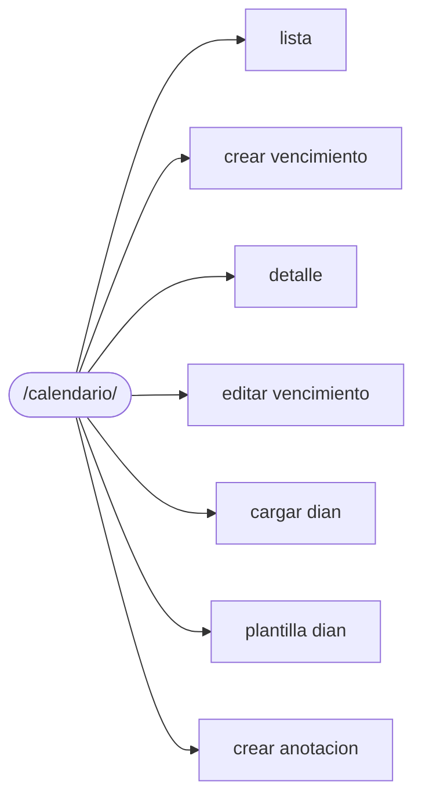

| Ruta | Nombre | Métodos | Admin. | Senior | Junior | Qué hace |
|---|---|---|---|---|---|---|
| `/calendario/` | `calendario:calendario` | GET | Sí | Sí | Sí | Calendario en vista mensual, semanal o diaria. |
| `/calendario/vencimientos/` | `calendario:lista` | GET | Sí | Sí | Sí | Listado tabular de vencimientos con filtros desplegables. |
| `/calendario/vencimientos/nuevo/` | `calendario:crear_vencimiento` | GET · POST | Sí | Sí | — | Registra un vencimiento manual (distrital, municipal o caso especial). |
| `/calendario/vencimientos/<int:pk>/` | `calendario:detalle` | GET | Sí | Sí | Sí | Detalle del vencimiento con sus alertas configuradas. |
| `/calendario/vencimientos/<int:pk>/editar/` | `calendario:editar_vencimiento` | GET · POST | Sí | Sí | — | Edita un vencimiento existente; la fecha siempre es editable. |
| `/calendario/vencimientos/<int:pk>/estado/` | `calendario:cambiar_estado` | POST | Sí | Sí | Sí | Actualiza el estado de presentación de un vencimiento (el Junior, solo los de sus clientes). |
| `/calendario/vencimientos/<int:pk>/validar/` | `calendario:validar` | POST | Sí | Sí | — | Marca un vencimiento automático DIAN como validado o pendiente. |
| `/calendario/generar/` | `calendario:generar` | POST | Sí | Sí | — | Calcula los vencimientos DIAN de todos los clientes activos. |
| `/calendario/clientes/<int:pk_cliente>/calcular/` | `calendario:calcular_cliente` | POST | Sí | Sí | — | Calcula los vencimientos DIAN de un solo cliente, desde su perfil. |
| `/calendario/dian/` | `calendario:cargar_dian` | GET · POST | Sí | — | — | Carga manual de una fila de la tabla de referencia DIAN (Administrador). |
| `/calendario/dian/importar/` | `calendario:importar_dian` | POST | Sí | — | — | Carga masiva de la tabla DIAN desde Excel (Administrador). |
| `/calendario/dian/plantilla/` | `calendario:plantilla_dian` | GET | Sí | — | — | Descarga la plantilla Excel de la tabla DIAN (Administrador). |
| `/calendario/vencimientos/<int:pk_vencimiento>/alertas/nueva/` | `calendario:crear_alerta` | POST | Sí | Sí | — | Agrega una alerta automática a un vencimiento. |
| `/calendario/alertas/<int:pk>/eliminar/` | `calendario:eliminar_alerta` | POST | Sí | Sí | — | Elimina una alerta configurada. |
| `/calendario/anotaciones/nueva/` | `calendario:crear_anotacion` | GET · POST | Sí | Sí | Sí | Crea una anotación libre del calendario (cualquier rol). |
| `/calendario/anotaciones/<int:pk>/eliminar/` | `calendario:eliminar_anotacion` | POST | Sí | Sí | Sí | Elimina una anotación; solo el autor o un Administrador. |

### MOD03 · Tablero de tareas Kanban

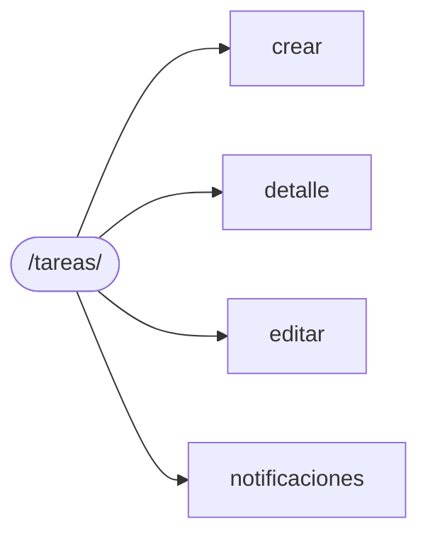

| Ruta | Nombre | Métodos | Admin. | Senior | Junior | Qué hace |
|---|---|---|---|---|---|---|
| `/tareas/` | `tareas:tablero` | GET | Sí | Sí | Sí | Tablero Kanban: columnas Por hacer / En progreso / En revisión / Terminado. |
| `/tareas/nueva/` | `tareas:crear` | GET · POST | Sí | Sí | — | Crea una nueva tarjeta del tablero (Administrador y Contador Senior). |
| `/tareas/<int:pk>/` | `tareas:detalle` | GET | Sí | Sí | Sí | Tarjeta expandida de la tarea: edición (Admin/Senior), cambio de estado, observaciones de avance, historial de cambios y acceso al expediente. |
| `/tareas/<int:pk>/editar/` | `tareas:editar` | GET · POST | Sí | Sí | — | Edita una tarea existente (Administrador y Contador Senior). |
| `/tareas/<int:pk>/eliminar/` | `tareas:eliminar` | POST | Sí | Sí | — | Elimina una tarea del tablero (operación irreversible). |
| `/tareas/<int:pk>/estado/` | `tareas:cambiar_estado` | POST | Sí | Sí | Sí | Cambia el estado de una tarea, por arrastre (AJAX) o por el selector de la tarjeta. El Contador Junior solo puede mover sus propias tareas. |
| `/tareas/<int:pk>/observaciones/` | `tareas:agregar_observacion` | POST | Sí | Sí | Sí | Registra una observación de avance sobre una tarea visible para el usuario. |
| `/tareas/notificaciones/` | `tareas:notificaciones` | GET | Sí | Sí | Sí | Cambios de estado recientes en las tareas del usuario, hechos por otra persona (endpoint AJAX para la campana de notificaciones del tablero). |

### MOD04 · Expedición de documentos y certificados

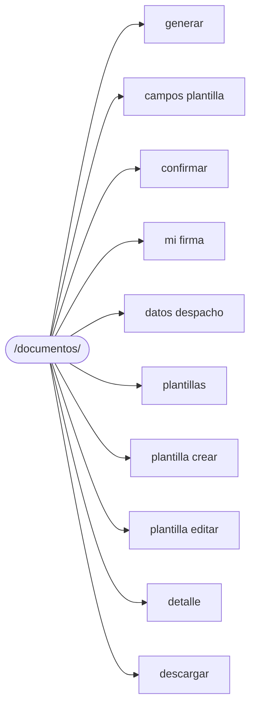

| Ruta | Nombre | Métodos | Admin. | Senior | Junior | Qué hace |
|---|---|---|---|---|---|---|
| `/documentos/` | `documentos:historico` | GET | Sí | Sí | Sí | Histórico de documentos generados, filtrable por tipo y rango de fechas. |
| `/documentos/generar/` | `documentos:generar` | GET · POST | Sí | Sí | Sí | Paso 1 del panel de generación: cliente, plantilla, período, descripción, firma y los campos propios de la plantilla elegida (cargados por AJAX). |
| `/documentos/generar/campos/` | `documentos:campos_plantilla` | GET | Sí | Sí | Sí | Fragmento AJAX con los campos propios de la plantilla elegida en el panel de generación. |
| `/documentos/generar/confirmar/` | `documentos:confirmar` | GET · POST | Sí | Sí | Sí | Paso 2: previsualización (GET) y generación del documento y su PDF (POST). |
| `/documentos/mi-firma/` | `documentos:mi_firma` | GET · POST | Sí | Sí | — | Carga o reemplaza la firma, identificación y tarjeta profesional propias. |
| `/documentos/datos-despacho/` | `documentos:datos_despacho` | GET · POST | Sí | — | — | Datos fijos del despacho y membrete de los documentos en PDF (solo Administrador). |
| `/documentos/plantillas/` | `documentos:plantillas` | GET | Sí | — | — | Catálogo de plantillas de documento (solo Administrador). |
| `/documentos/plantillas/nueva/` | `documentos:plantilla_crear` | GET · POST | Sí | — | — | Crea una plantilla nueva con sus campos propios (solo Administrador). |
| `/documentos/plantillas/<int:pk>/editar/` | `documentos:plantilla_editar` | GET · POST | Sí | — | — | Edita el texto predeterminado y los campos de una plantilla (solo Administrador). |
| `/documentos/<int:pk>/` | `documentos:detalle` | GET | Sí | Sí | Sí | Detalle de un documento generado, con el texto del certificado renderizado. |
| `/documentos/<int:pk>/descargar/` | `documentos:descargar` | GET | Sí | Sí | Sí | Descarga individual del PDF ya generado. |
| `/documentos/<int:pk>/eliminar/` | `documentos:eliminar` | POST | Sí | Sí | — | Elimina un documento generado (operación irreversible). |

### MOD05 · Hallazgos y revisiones

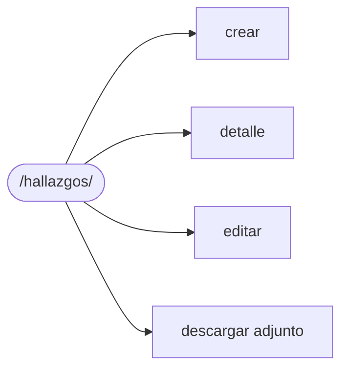

| Ruta | Nombre | Métodos | Admin. | Senior | Junior | Qué hace |
|---|---|---|---|---|---|---|
| `/hallazgos/` | `hallazgos:lista` | GET | Sí | Sí | Sí | Listado filtrable de hallazgos y revisiones. |
| `/hallazgos/nuevo/` | `hallazgos:crear` | GET · POST | Sí | Sí | Sí | Registra un nuevo hallazgo (cliente restringido para el Contador Junior). |
| `/hallazgos/<int:pk>/` | `hallazgos:detalle` | GET | Sí | Sí | Sí | Detalle del hallazgo: edición, cambio de estado y adjuntos de soporte. |
| `/hallazgos/<int:pk>/editar/` | `hallazgos:editar` | GET · POST | Sí | Sí | Sí | Edita los datos de registro de un hallazgo visible para el usuario. |
| `/hallazgos/<int:pk>/eliminar/` | `hallazgos:eliminar` | POST | Sí | Sí | — | Elimina un hallazgo y sus adjuntos (Administrador y Contador Senior). |
| `/hallazgos/<int:pk>/estado/` | `hallazgos:cambiar_estado` | POST | Sí | Sí | Sí | Cambia el estado de un hallazgo visible para el usuario. |
| `/hallazgos/<int:pk>/adjuntos/` | `hallazgos:agregar_adjunto` | POST | Sí | Sí | Sí | Agrega un archivo de soporte a un hallazgo visible para el usuario. |
| `/hallazgos/adjuntos/<int:pk>/eliminar/` | `hallazgos:eliminar_adjunto` | POST | Sí | Sí | Sí | Elimina un adjunto de un hallazgo visible para el usuario. |
| `/hallazgos/adjuntos/<int:pk>/descargar/` | `hallazgos:descargar_adjunto` | GET | Sí | Sí | Sí | Descarga el archivo de soporte de un hallazgo visible para el usuario. |

### MOD06 · Honorarios, cartera y cuentas de cobro

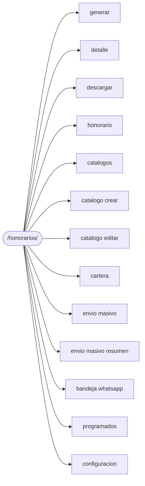

| Ruta | Nombre | Métodos | Admin. | Senior | Junior | Qué hace |
|---|---|---|---|---|---|---|
| `/honorarios/` | `finanzas:historico` | GET | Sí | Sí | Sí | Histórico de cuentas de cobro, filtrable por cliente, estado, período y fechas. |
| `/honorarios/cuentas-cobro/generar/` | `finanzas:generar` | GET · POST | Sí | — | — | Genera una cuenta de cobro (solo Administrador). Al elegir el cliente (`?cliente=<id>`) se sugieren el valor total según su honorario y una línea por cada tipo de servicio que recibe (HU049). |
| `/honorarios/cuentas-cobro/<int:pk>/` | `finanzas:detalle` | GET | Sí | Sí | Sí | Detalle de una cuenta de cobro visible para el usuario. |
| `/honorarios/cuentas-cobro/<int:pk>/descargar/` | `finanzas:descargar` | GET | Sí | Sí | Sí | Descarga el PDF de una cuenta de cobro visible para el usuario. |
| `/honorarios/cuentas-cobro/<int:pk>/eliminar/` | `finanzas:eliminar` | POST | Sí | — | — | Elimina una cuenta de cobro sin abonos (solo Administrador). |
| `/honorarios/clientes/<int:pk>/honorario/` | `finanzas:honorario` | GET · POST | Sí | — | — | Configura el tipo y monto del honorario de un cliente (solo Administrador). |
| `/honorarios/catalogos/` | `finanzas:catalogos` | GET | Sí | — | — | Conceptos facturables, cuentas bancarias y métodos de pago en una sola pantalla. |
| `/honorarios/catalogos/<str:catalogo>/nuevo/` | `finanzas:catalogo_crear` | GET · POST | Sí | — | — | Crea (sin `pk`) o edita (con `pk`) un elemento de cualquiera de los catálogos. |
| `/honorarios/catalogos/<str:catalogo>/<int:pk>/editar/` | `finanzas:catalogo_editar` | GET · POST | Sí | — | — | Crea (sin `pk`) o edita (con `pk`) un elemento de cualquiera de los catálogos. |
| `/honorarios/catalogos/<str:catalogo>/<int:pk>/eliminar/` | `finanzas:catalogo_eliminar` | POST | Sí | — | — | Elimina un elemento de catálogo que no esté usado en cuentas de cobro o abonos. |
| `/honorarios/cuentas-cobro/<int:pk>/abonos/` | `finanzas:registrar_abono` | POST | Sí | — | — | Registra un pago o abono a una cuenta de cobro (solo Administrador, HU016). |
| `/honorarios/cartera/` | `finanzas:cartera` | GET | Sí | Sí | Sí | Panel de cartera (HU016-4, HU017): por cliente, facturado, cobrado, saldo y días en mora, con indicador rojo a más de 30 días. El Contador Senior y el Junior ven solo sus clientes asignados. |
| `/honorarios/cuentas-cobro/<int:pk>/enviar/` | `finanzas:enviar` | POST | Sí | — | — | Envía o programa el envío de una cuenta de cobro o de un recordatorio (HU045, HU047). |
| `/honorarios/envio-masivo/` | `finanzas:envio_masivo` | GET · POST | Sí | — | — | Envío masivo de cuentas de cobro o recordatorios (HU046, HU047) en tres pasos: selección de cuentas, canal y momento → confirmación del listado → resumen de éxitos y fallos. |
| `/honorarios/envio-masivo/resumen/` | `finanzas:envio_masivo_resumen` | GET | Sí | — | — | Resumen del último envío masivo con el detalle de cada caso (HU046-4). |
| `/honorarios/whatsapp-pendientes/` | `finanzas:bandeja_whatsapp` | GET | Sí | — | — | WhatsApp programados o masivos que esperan que alguien pulse "Enviar". |
| `/honorarios/envios/` | `finanzas:programados` | GET | Sí | — | — | Control de los envíos programados: próximos, procesados y cancelados. |
| `/honorarios/envios/<int:pk>/whatsapp/` | `finanzas:abrir_whatsapp` | POST | Sí | — | — | Registra como enviado un WhatsApp pendiente y redirige al enlace `wa.me` con el mensaje ya escrito. Se usa por POST (con token CSRF) porque cambia el estado del envío. |
| `/honorarios/envios/<int:pk>/reintentar/` | `finanzas:reintentar` | POST | Sí | — | — | Reintenta un correo fallido (HU045-2). |
| `/honorarios/envios/<int:pk>/cancelar/` | `finanzas:cancelar_envio` | POST | Sí | — | — | Cancela un envío programado o un WhatsApp pendiente. |
| `/honorarios/configuracion/` | `finanzas:configuracion` | GET · POST | Sí | — | — | Configura el cobro mensual automático y los recordatorios automáticos. |
| `/honorarios/configuracion/ejecutar/` | `finanzas:ejecutar_proceso` | POST | Sí | — | — | Ejecuta ya el proceso automático (lo mismo que hace el cron con `procesar_cobros`). |

### MOD07 · Comunicaciones integradas

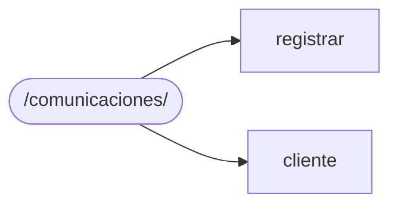

| Ruta | Nombre | Métodos | Admin. | Senior | Junior | Qué hace |
|---|---|---|---|---|---|---|
| `/comunicaciones/` | `comunicaciones:lista` | GET | Sí | Sí | Sí | Historial general de comunicaciones de los clientes visibles (acceso desde el menú). |
| `/comunicaciones/registrar/` | `comunicaciones:registrar` | GET · POST | Sí | Sí | — | Registro manual de una llamada, reunión u otro contacto (Administrador y Senior). |
| `/comunicaciones/cliente/<int:pk_cliente>/` | `comunicaciones:cliente` | GET | Sí | Sí | Sí | Historial de comunicaciones de un cliente (acceso desde su ficha). |

### MOD08 · Gestión de equipo y roles

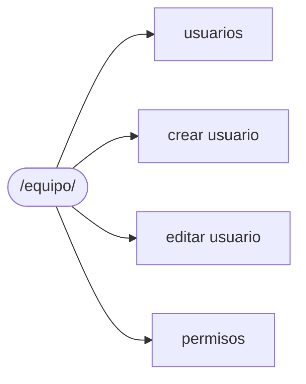

| Ruta | Nombre | Métodos | Admin. | Senior | Junior | Qué hace |
|---|---|---|---|---|---|---|
| `/equipo/` | `seguridad:equipo` | GET | Sí | Sí | — | Resumen de tareas y vencimientos de cada miembro (Administrador y Senior, solo consulta). |
| `/equipo/usuarios/` | `seguridad:usuarios` | GET | Sí | — | — | Listado del equipo con filtros por nombre, rol y estado. |
| `/equipo/usuarios/nuevo/` | `seguridad:crear_usuario` | GET · POST | Sí | — | — | Alta de un usuario con rol y contraseña temporal; revisa los permisos del rol (HU022-2). |
| `/equipo/usuarios/<int:pk>/editar/` | `seguridad:editar_usuario` | GET · POST | Sí | — | — | Edita datos, correo, rol y contraseña temporal de un usuario. |
| `/equipo/usuarios/<int:pk>/estado/` | `seguridad:estado_usuario` | POST | Sí | — | — | Activa o inactiva un usuario (POST). |
| `/equipo/usuarios/<int:pk>/eliminar/` | `seguridad:eliminar_usuario` | POST | Sí | — | — | Elimina un usuario sin historial (POST); si tiene historial se sugiere inactivarlo. |
| `/equipo/permisos/` | `seguridad:permisos` | GET · POST | Sí | — | — | Interruptores de habilitación de cada módulo por rol. |

### MOD09 · Expediente y bitácora por cliente

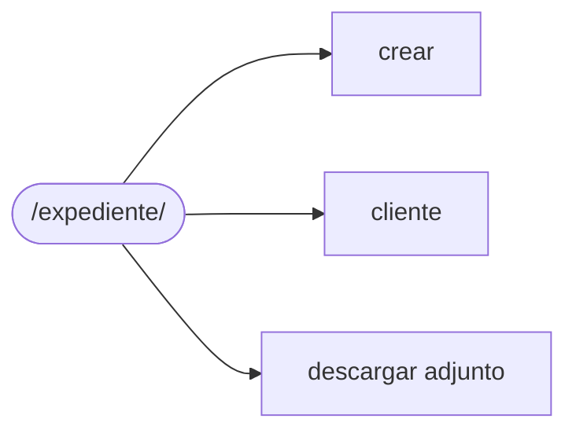

| Ruta | Nombre | Métodos | Admin. | Senior | Junior | Qué hace |
|---|---|---|---|---|---|---|
| `/expediente/` | `expediente:lista` | GET | Sí | Sí | Sí | Bitácora general: anotaciones de todos los clientes visibles, con filtro por cliente, tipo y rango de fechas (acceso desde el menú y el panel). |
| `/expediente/nueva/` | `expediente:crear` | GET · POST | Sí | Sí | Sí | Registra una anotación con sus archivos de soporte. |
| `/expediente/cliente/<int:pk_cliente>/` | `expediente:cliente` | GET | Sí | Sí | Sí | Expediente completo de un cliente (acceso desde su ficha y el tablero Kanban). |
| `/expediente/<int:pk>/archivar/` | `expediente:archivar` | POST | Sí | — | — | Archiva o restaura una anotación (solo el Administrador). |
| `/expediente/<int:pk>/restaurar/` | `expediente:restaurar` | POST | Sí | — | — | Archiva o restaura una anotación (solo el Administrador). |
| `/expediente/adjuntos/<int:pk>/descargar/` | `expediente:descargar_adjunto` | GET | Sí | Sí | Sí | Descarga un archivo de soporte de una anotación visible para el usuario. |

### MOD10 · Reportes y análisis

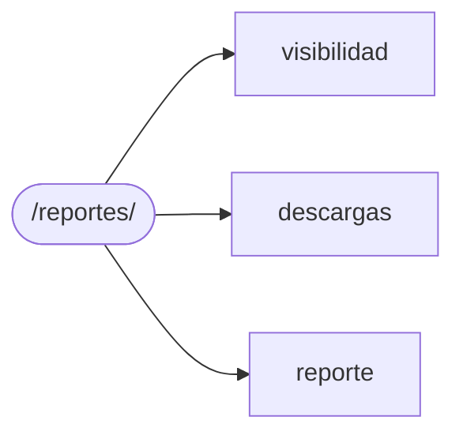

| Ruta | Nombre | Métodos | Admin. | Senior | Junior | Qué hace |
|---|---|---|---|---|---|---|
| `/reportes/` | `reportes:inicio` | GET | Sí | Sí | Sí | Tarjetas de los reportes visibles para el rol del usuario. |
| `/reportes/visibilidad/` | `reportes:visibilidad` | GET · POST | Sí | — | — | Qué roles ven cada reporte; el Administrador los ve todos. |
| `/reportes/descargas/` | `reportes:descargas` | GET | Sí | — | — | Historial de descargas: reporte, usuario, fecha, formato y filtros usados (HU028-5). |
| `/reportes/<slug:slug>/` | `reportes:reporte` | GET | Sí | Sí | Sí | Filtros, vista previa y descarga en Excel o PDF de un reporte. |

## 3. Resumen de acceso por rol y módulo

Número de rutas que cada rol puede abrir, sobre el total del módulo.

| Módulo | Rutas | Administrador | Contador Senior | Contador Junior |
|---|---|---|---|---|
| Sin módulo | 11 | 11 | 11 | 11 |
| MOD01 · Gestión de clientes | 12 | 12 | 12 | 6 |
| MOD02 · Calendario | 16 | 16 | 13 | 6 |
| MOD03 · Tablero de tareas Kanban | 8 | 8 | 8 | 5 |
| MOD04 · Expedición de documentos y certificados | 12 | 12 | 8 | 6 |
| MOD05 · Hallazgos y revisiones | 9 | 9 | 9 | 8 |
| MOD06 · Honorarios, cartera y cuentas de cobro | 22 | 22 | 4 | 4 |
| MOD07 · Comunicaciones integradas | 3 | 3 | 3 | 2 |
| MOD08 · Gestión de equipo y roles | 7 | 7 | 1 | 0 |
| MOD09 · Expediente y bitácora por cliente | 6 | 6 | 4 | 4 |
| MOD10 · Reportes y análisis | 4 | 4 | 2 | 2 |

Entradas del menú que además se ocultan por rol: `seguridad:equipo`.
